# Architecture — One Intellectt

Diagrams are written in [Mermaid](https://mermaid.js.org). They render on GitHub,
GitLab and in VS Code (with a Mermaid extension). A standalone picture of the system
is in [architecture.png](architecture.png) (vector version: [architecture.svg](architecture.svg)).

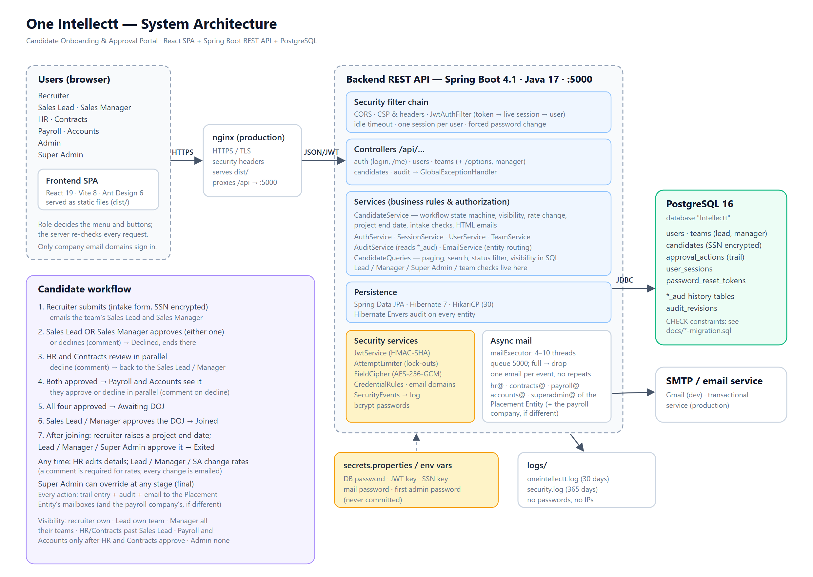

---

## 1. System context

Who uses the system, and which outside systems it talks to.

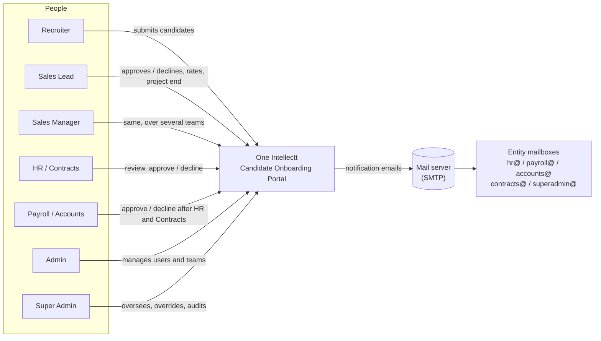

---

## 2. Containers

The deployable pieces and how they communicate.

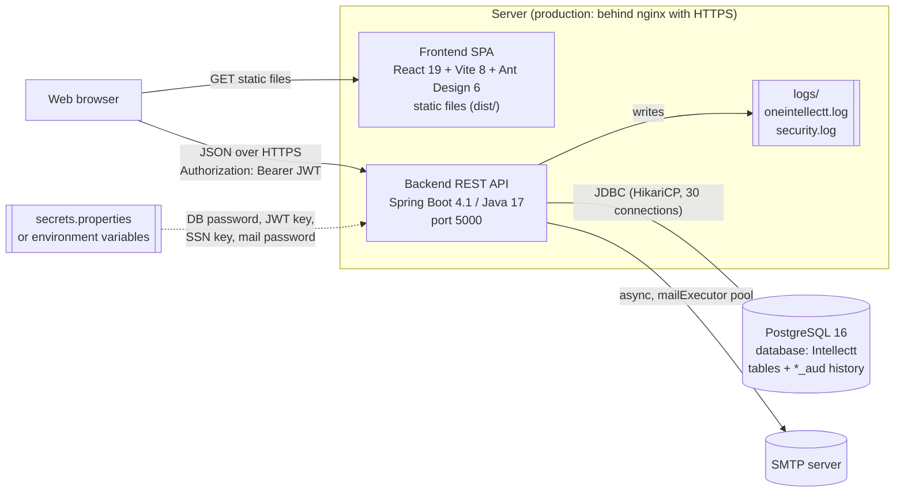

| Container | Technology | Responsibility |
|---|---|---|
| Frontend | React 19, React Router 7, Ant Design 6, axios, dayjs; built by Vite 8 | Screens, forms, client-side checks (convenience only), session idle warning |
| Backend | Spring Boot 4.1.1 (Web MVC, Security 7, Data JPA / Hibernate 7, Envers, Mail), jjwt 0.12 | All business rules, authorization, workflow, email, audit, security logging |
| Database | PostgreSQL 16 | Operational data and full change history |
| Mail | Any SMTP (Gmail in development) | Delivering notifications |

---

## 3. Backend components

Layered: controller → service → repository. Cross-cutting concerns sit in
`security`, `config`, `audit` and `exception`.

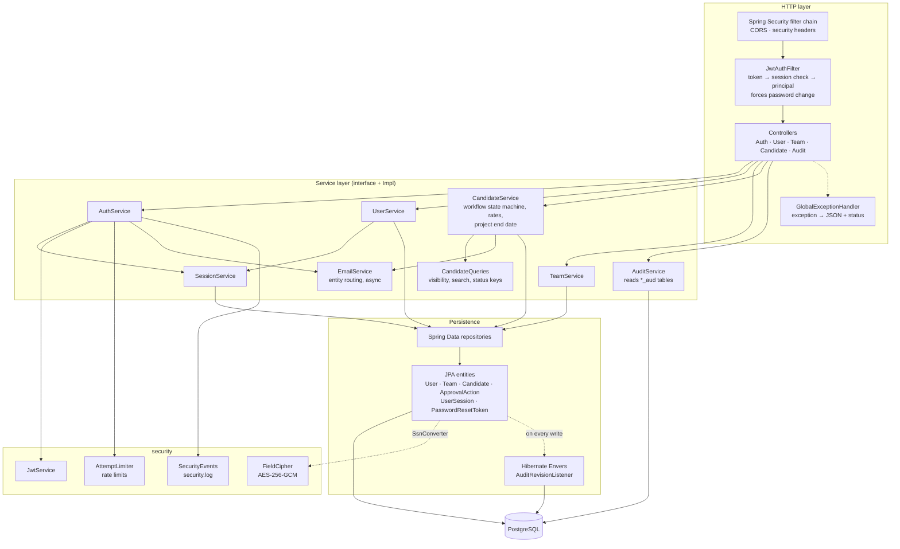

| Package | Contents |
|---|---|
| `controller` | `AuthController`, `UserController`, `TeamController`, `CandidateController`, `AuditController` — thin; pass the signed-in user to services |
| `service` | Interfaces + `*Impl`: auth, users, teams, candidates (workflow, HR edit, rates, project end date, email HTML), sessions, email, audit; `CandidateQueries` (Specifications), `CredentialRules` (password/email rules), `AllowedEmailDomains` (company email ids only) |
| `repository` | Spring Data JPA repositories; `@EntityGraph` on list/detail queries to avoid N+1 |
| `model`, `model.enums` | JPA entities used directly as JSON bodies; `SsnConverter` |
| `security` | `JwtService`, `JwtAuthFilter`, `RestAuthenticationEntryPoint`, `AppUserPrincipal`, `CustomUserDetailsService`, `AttemptLimiter`, `FieldCipher`, `SecurityEvents` |
| `config` | `SecurityConfig`, `AsyncConfig` (mail pool), `EntityMailProperties`, `DataInitializer` (first Super Admin), `AuditLoggingGuard`, `SsnEncryptionMigration` |
| `audit` | `AuditRevision` (`audit_revisions`), `AuditRevisionListener` (who made the change) |
| `exception` | `BadRequestException` (400), `ForbiddenException` (403), `ResourceNotFoundException` (404), `TooManyRequestsException` (429), `GlobalExceptionHandler` |

---

## 4. Frontend structure

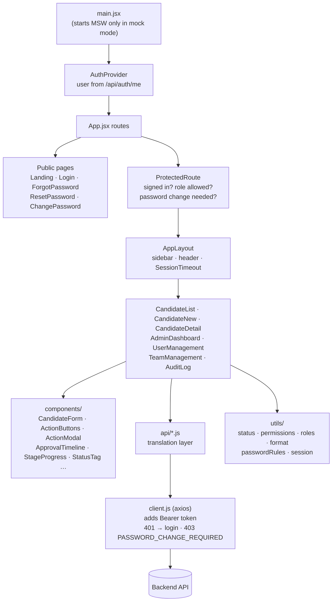

- **`src/api/` is the only place that knows the backend's JSON shapes.** It maps them
  to the shapes the components use (e.g. backend `status` + branch decisions →
  `stages` + `override`; `jobRole` → `role`; `ssnMasked` → `ssn`).
- **Routes and roles:** `/candidates*` for workflow roles, `/candidates/new` for
  Recruiters, `/admin` (dashboard) and `/admin/audit` for Super Admin, `/admin/users`
  for Super Admin/Admin, `/admin/teams` for Super Admin/Admin/Sales Lead/Sales Manager.
- **State:** the signed-in user lives in React context. Only the token, idle-timer data
  and a sign-out message are in browser storage.

---

## 5. Key flows

### 5.1 Sign-in and an authenticated request

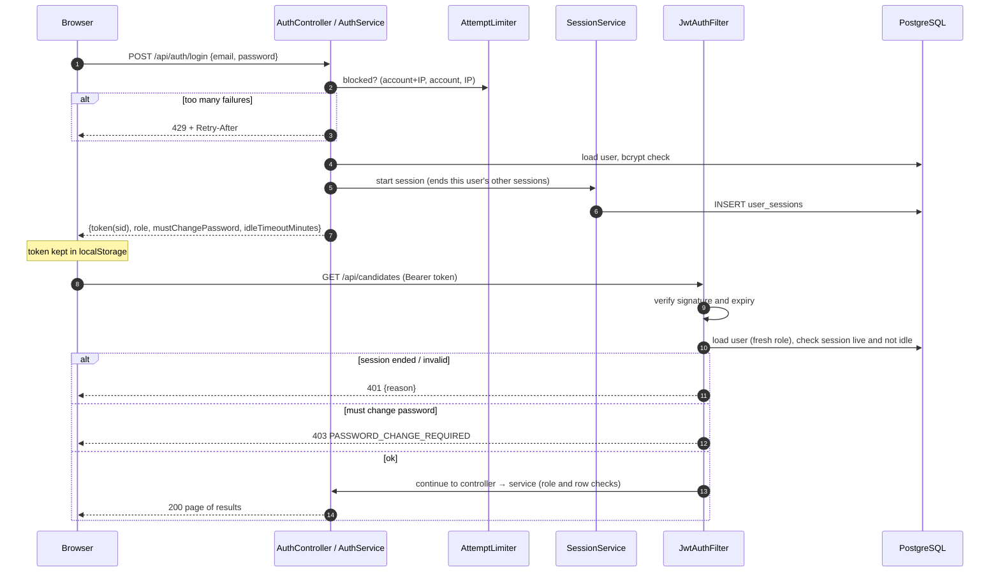

### 5.2 Workflow action with email and audit

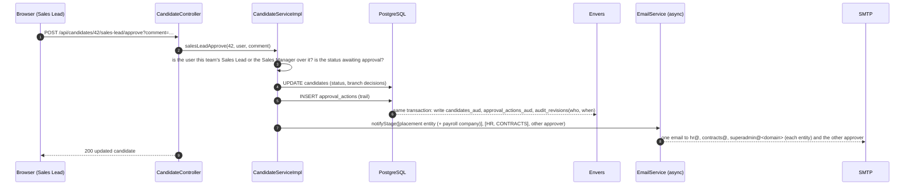

### 5.3 Password reset

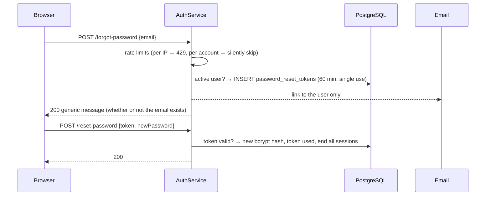

---

### 5.4 Project end date and exit

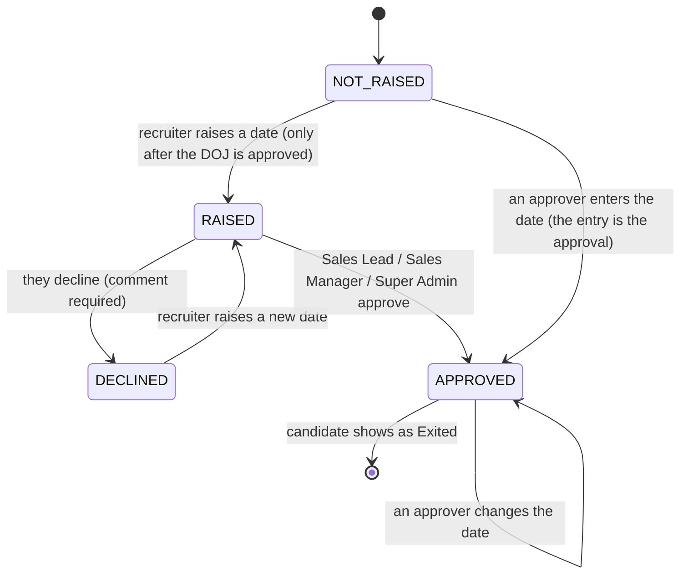

### 5.5 Which mailboxes an email goes to

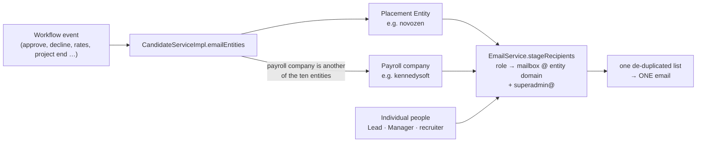

If the payroll company is the same as the Placement Entity, is "Other", or is empty, only the
Placement Entity's mailboxes are used.

---

## 6. Deployment view (recommended production)

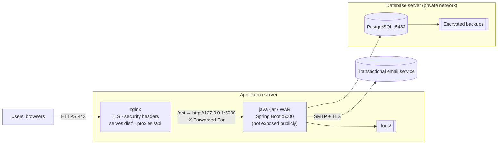

Step-by-step: [DEPLOYMENT.md](DEPLOYMENT.md).

Scaling out: sessions and all state are in PostgreSQL, so a second backend instance
can be added behind nginx. Keep *pool size × instances* below PostgreSQL's
`max_connections`, and move the in-memory rate-limit counters to shared storage.

---

## 7. Cross-cutting concerns

| Concern | Where it's handled |
|---|---|
| Authentication | `JwtAuthFilter`, `JwtService`, `SessionServiceImpl`, `AuthServiceImpl` |
| Authorization | Each `*ServiceImpl` (role/team checks), `CandidateQueries.visibleTo` |
| Validation | `CredentialRules`, service checks, `GlobalExceptionHandler` (400s) |
| Auditing | Hibernate Envers (`@Audited` on every entity), `AuditRevisionListener` |
| Security logging | `SecurityEvents` → `logs/security.log` |
| Encryption | `FieldCipher` + `SsnConverter`; keys from configuration |
| Transactions | `@Transactional` on service methods; OSIV disabled |
| Async work | `AsyncConfig.mailExecutor` |
| Configuration | `application.properties` (+ `application-test.properties`), `secrets.properties`, environment variables |
