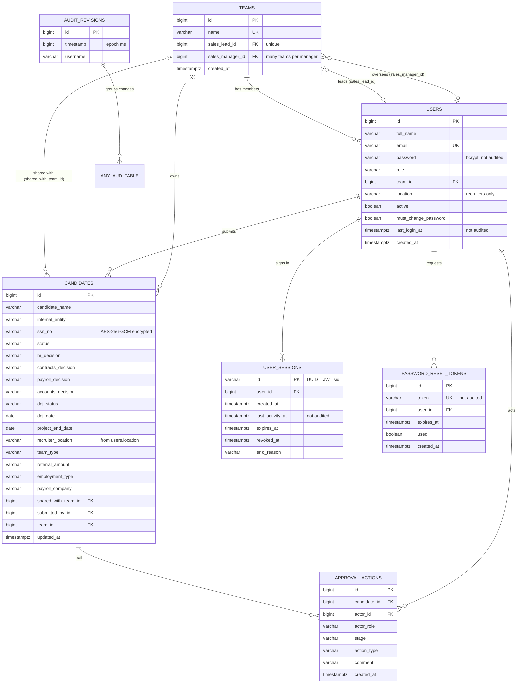

# Data Model — One Intellectt

PostgreSQL 16, database `Intellectt` (tests: `intellectt_test`; load tests:
`intellectt_load`). Tables are created and extended by Hibernate
(`spring.jpa.hibernate.ddl-auto=update`) from the JPA entities in
`src/main/java/com/intellectt/model`.

## 1. Entity-relationship diagram

## 2. Tables

### `users`
| Column | Type | Notes |
|---|---|---|
| `id` | bigint PK | identity |
| `full_name` | varchar, not null | |
| `email` | varchar, not null, **unique** | sign-in name |
| `password` | varchar, not null | bcrypt hash. Never returned in JSON, never audited |
| `role` | varchar, not null | `RECRUITER`, `SALES_LEAD`, `SALES_MANAGER`, `HR`, `CONTRACTS`, `PAYROLL`, `ACCOUNTS`, `ADMIN`, `SUPER_ADMIN` (DB CHECK constraint `users_role_check`) |
| `team_id` | bigint FK → `teams` | Recruiters and Sales Leads only |
| `location` | varchar | Recruiters only: their office (Hyderabad, Vijayawada, Banglore, Indore, Noida, USA). Copied to `candidates.recruiter_location` on submit |
| `active` | boolean, not null | false = deactivated |
| `must_change_password` | boolean, not null, default false | true while the password is admin-set |
| `last_login_at` | timestamptz | for access reviews; not audited |
| `created_at` | timestamptz, not null | |

### `teams`
| Column | Type | Notes |
|---|---|---|
| `id` | bigint PK | |
| `name` | varchar, not null, **unique** | |
| `sales_lead_id` | bigint FK → `users`, **unique** | one lead per team |
| `sales_manager_id` | bigint FK → `users` | not unique: one Sales Manager oversees many teams |
| `created_at` | timestamptz | |

### `candidates`
| Group | Columns |
|---|---|
| Candidate & recruiter | `candidate_name` (not null), `candidate_personal_email`, `candidate_direct_number`, `recruiter_name`, `lead_or_team_name`, `internal_entity` |
| Client | `client_name`, `client_reporting_manager`, `reporting_manager_email`, `reporting_manager_contact` |
| Payroll company | `payroll_company` (optional: one of the ten entities, or `Other`), `payroll_company_other` (the typed name, only for `Other`, max 100) |
| Placement | `sourcing_recruiter` and `sourcing_recruiter_lead` (both optional), `client_state`, `client_location` (two separate fields), `employment_type` (W2, C2C, Full-time, Self), `internal_company_placement` + `placement_company` (set only when Yes), `shared_placement` + `shared_with_team_id` FK → `teams` (set only when Yes) |
| Team type, referral | `team_type` (`SALES`, `REQ`, `BOTH` = Sales & Req), `referral_amount` (optional number kept as typed) |
| Recruiter | `recruiter_location` (Hyderabad, Vijayawada, Banglore, Indore, Noida, USA; checked on submit). The Sales Lead / Manager names in responses are computed from the team, not stored |
| Engagement & compliance | `vendor`, `job_role`, `location`, `bill_rate`, `pay_rate`, `start_date`, `cc_company`, `referral`, **`ssn_no`** (encrypted), `visa_status`, `work_authorization_exp_date`, `relocation_expenses`, `pay_cycle`, `existing_employee`, `job_description` (≤ 4000) |
| Workflow | `discount_price` (optional dollars). `vendor_percentage` and `discounted_bill_rate` are **not columns**: they are computed from `pay_rate` / `bill_rate` / `discount_price` for every response. `project_end_date` and `project_end_status` (`NOT_RAISED`, `RAISED`, `APPROVED` = exited, `DECLINED`; only after the DOJ is approved), `status`, `hr_decision`, `contracts_decision`, `payroll_decision`, `accounts_decision` (default `PENDING`), `doj_status` (all not null, stored as enum names), `doj_date`, `last_decline_reason` (≤ 2000) |
| Ownership | `submitted_by_id` FK → `users` (not null), `team_id` FK → `teams` |
| Timestamps | `created_at`, `updated_at` (not null) |

Other text columns are `varchar(255)`. Longer input is rejected with a 400.

### `approval_actions` — the approval trail
One row per workflow action: `candidate_id`, `actor_id`, `actor_role`, `stage`,
`action_type`, `comment` (≤ 2000), `created_at`.

### `user_sessions`
`id` is a random UUID, which is also the `sid` claim in the JWT. A session is live while
`revoked_at` is null, the idle limit hasn't passed since `last_activity_at` (updated at
most every 30 s), and `expires_at` is in the future. `end_reason` holds a
`SessionEndReason` name.

### `password_reset_tokens`
Single-use (`used`), expires 60 minutes after creation. The token value is not audited.

## 3. Audit (history) tables

Hibernate Envers keeps a `<table>_aud` copy of every row version for every table above:
`users_aud`, `teams_aud`, `candidates_aud`, `approval_actions_aud`,
`user_sessions_aud`, `password_reset_tokens_aud`. Each row has:

- `rev` → `audit_revisions.id`, which records **who** (`username`: the signed-in email,
  `anonymous` or `system`) and **when** (`timestamp`, epoch ms).
- `revtype`: `0` insert, `1` update, `2` delete. Deleted rows keep their last values
  (`store_data_at_delete=true`).

Not copied: `users.password`, `password_reset_tokens.token`,
`user_sessions.last_activity_at`, `users.last_login_at`. `candidates_aud.ssn_no` holds
the encrypted value. IP addresses are not recorded anywhere.

## 4. Indexes

| Index | Columns | Used by |
|---|---|---|
| `idx_candidates_submitted_by` | `candidates(submitted_by_id)` | recruiter's list |
| `idx_candidates_team` | `candidates(team_id)` | Sales Lead's list |
| `idx_candidates_status` | `candidates(status)` | HR/Contracts lists, status filter |
| `idx_candidates_updated_at` | `candidates(updated_at)` | list sort (latest activity first) |
| `idx_approval_actions_candidate` | `approval_actions(candidate_id)` | trail |
| `idx_user_sessions_user` | `user_sessions(user_id)` | sign-in (ending other sessions) |

Plus the unique indexes on `users.email`, `teams.name`, `teams.sales_lead_id` and
`password_reset_tokens.token`.

## 5. Schema changes and migrations

`ddl-auto=update` adds new tables and columns automatically, but it does **not** change
existing constraints or drop anything. Changes that needed manual SQL so far:

Run these once per database (the real one, `intellectt_test`, `intellectt_load`), **in this order**,
after a backup. Each is idempotent (`DROP CONSTRAINT IF EXISTS`, then re-created):

| Order | File | What it allows |
|---|---|---|
| 1 | `docs/sales-manager-migration.sql` | role `SALES_MANAGER` (users, actor_role), status `SALES_LEAD_DECLINED` |
| 2 | `docs/payroll-accounts-migration.sql` | status `IN_PAYROLL_ACCOUNTS_REVIEW`, trail stages `PAYROLL` and `ACCOUNTS` |
| 3 | `docs/project-end-migration.sql` | trail stage `PROJECT_END`, action `SET_PROJECT_END` |
| 4 | `docs/rate-change-migration.sql` | action `RATE_CHANGE` |
| 5 | `docs/candidate-edit-migration.sql` | action `EDIT` (HR edits details) |
| 6 | `docs/project-end-approval-migration.sql` | actions `RAISE_PROJECT_END`, `APPROVE_PROJECT_END`, `DECLINE_PROJECT_END` |

(The `ADMIN` role was added earlier by hand the same way.) The new columns themselves
(`teams.sales_manager_id`, `payroll_decision`, `accounts_decision`, `project_end_date`, the intake fields)
are added by `ddl-auto=update` on the next start. `docs/sample-candidates.sql` inserts two sample
candidates directly (no email, no audit entries)

At startup, `SsnEncryptionMigration` encrypts any SSN still stored as plain text in
`candidates`. It's idempotent.

**Recommendation:** before production schema changes become frequent, switch to
Flyway or Liquibase with versioned scripts, and set `ddl-auto=validate`.

## 6. Data protection summary

| Data | Protection |
|---|---|
| Passwords | bcrypt; write-only in JSON; not in history |
| SSN | AES-256-GCM at rest (incl. history); API returns only `***-**-1234` |
| Reset tokens | Single use, 60 minutes; not in history |
| Everything | Change history with author; DB access restricted to the app (see DEPLOYMENT.md) |
