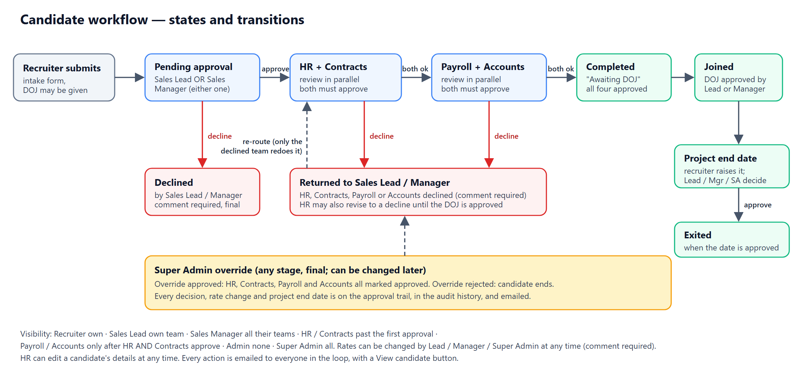
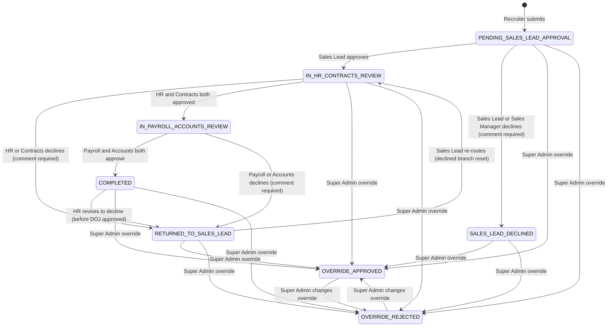

# Technical Design Document — One Intellectt

| | |
|---|---|
| **System** | One Intellectt — Candidate Onboarding & Approval Portal |
| **Components** | Backend `OneIntellectt` (Spring Boot) · Frontend `onboarding-portal` (React) · PostgreSQL |
| **Version** | 0.0.1-SNAPSHOT |
| **Status** | Built and tested; pre-production |
| **Last updated** | 27 Oct 2026 |

Related documents: [Architecture](ARCHITECTURE.md) · [API reference](API.md) ·
[Data model](DATA_MODEL.md) · [Deployment](DEPLOYMENT.md) ·
[Security](../SECURITY.md) · [ISO 27001 mapping](../COMPLIANCE.md) ·
[Testing & load test](../load-test/README.md)

---

## 1. Purpose and scope

### 1.1 Problem
When a recruiter places a candidate with a client, several departments must review
and sign off before the candidate starts work: the recruiter's Sales Lead (or the Sales
Manager over the team), HR and Contracts, then Payroll and Accounts. This used to be handled by email and
spreadsheets, with no single record of who approved what and when.

### 1.2 Goals
- One record per placed candidate that moves through a defined approval workflow.
- Each role sees only the candidates it needs to see, and can act only at its own stage.
- Automatic email at every stage to the right mailboxes of the candidate's legal entity.
- A complete, tamper-resistant history of every decision and every data change.
- Usable by about 1000 concurrent users. Secure enough for personal data (SSN), and aligned with ISO/IEC 27001.

### 1.3 Out of scope (current version)
- Single sign-on (SSO) and multi-factor sign-in (MFA planned for admins; see §11).
- Editing a candidate after submission is limited to **HR** (any details, any time) and, for the bill and pay rates only, the Sales Lead / Manager / Super Admin. A decline is resolved by the Sales Lead / Manager re-routing.
- Standalone comments outside a workflow action.
- Data retention / automatic deletion (needs a business decision first).

### 1.4 Glossary
| Term | Meaning |
|---|---|
| **Candidate** | A person placed with a client; the record that moves through the workflow. |
| **Placement Entity** | The Intellectt legal entity employing the candidate (e.g. `novozen`). Decides which email domain notifications go to. |
| **DOJ** | Date of Joining. Supplied by the recruiter at intake. It needs **two approvals**: the Sales Lead or Sales Manager, **and** HR. |
| **Drop out / back out** | The candidate leaves after the DOJ was approved. Recorded (with a reason) by the Lead, Manager, HR, Contracts, Payroll, Accounts or the Super Admin; status `DROPPED_OUT`, counted on the Super Admin's Drop Outs card. |
| **Sales Manager** | Oversees several teams; has the same approval powers as a team's Sales Lead over them. Either one is enough. |
| **Branch** | HR, Contracts, Payroll and Accounts each make their own decision ("branch"): HR and Contracts in parallel, then Payroll and Accounts in parallel. |
| **Payroll company** | Optional: the company running the candidate's payroll (one of the ten entities, or "Other" with a typed name). When it differs from the Placement Entity, stage emails also go to its mailboxes. |
| **Project end date** | When the engagement ends; set by the Sales Lead / Manager after the DOJ is approved. |
| **Override** | A final approve/reject by the Super Admin that ends the normal workflow. |
| **Session** | A server-side sign-in record; every token is tied to one. |

---

## 2. Users and roles

| Role | Responsibility | Sees | Can do |
|---|---|---|---|
| `RECRUITER` | Submits placed candidates | Own submissions | Submit |
| `SALES_LEAD` | First approval gate for their team | Their team's candidates; their team | Approve / decline / re-route; approve DOJ (HR must approve it too); approve the project end date (HR too); drop out; set project end date; change rates; add/remove recruiters in own team |
| `SALES_MANAGER` | Same gate, over several teams | Candidates and teams of every team under them | Same as a Sales Lead for those teams. Either one is enough |
| `HR` | Reviews (parallel with Contracts) | Candidates past Sales Lead / Manager approval | Approve / decline; may revise until DOJ approved; **edit the candidate's details at any time**; **approves the DOJ and the project end date** (with the Lead / Manager); drop out |
| `CONTRACTS` | Reviews (parallel with HR) | Candidates past Sales Lead / Manager approval | Approve / decline |
| `PAYROLL` | Payroll setup | Candidates HR **and** Contracts have both approved | Approve / decline (comment on decline) |
| `ACCOUNTS` | Billing setup | Candidates HR **and** Contracts have both approved | Approve / decline (comment on decline) |
| `ADMIN` | User & team administration | Users and teams, **no candidates** | Manage users (except Super Admin) and teams; put a Sales Manager over teams |
| `SUPER_ADMIN` | Oversight (CEO/President) | Everything, incl. audit log | Override any candidate; change rates; manage everything |

Authorization is enforced in the **service layer** of the backend on every request.
The frontend hides buttons and pages only for convenience. The rules are tested
role-by-endpoint in `RoleAccessApiTest`.

---

## 3. Architecture overview

A three-tier web application:

```
Browser (React SPA)  ──HTTPS/JSON, JWT──►  Spring Boot REST API  ──JDBC──►  PostgreSQL
                                                 └──SMTP (async)──►  Mail server
```

- **Frontend:** a single-page app (React 19, Vite 8, Ant Design 6). Holds no business
  rules that matter for security, and talks to the API only through `src/api/*.js`.
- **Backend:** a stateless REST API (Spring Boot 4.1, Java 17). It enforces every rule,
  owns the workflow state machine, sends email, and writes the audit trail.
- **Database:** PostgreSQL 16. Operational tables plus Hibernate Envers `*_aud` history tables.

Detailed diagrams (context, containers, components, sequences, deployment):
**[ARCHITECTURE.md](ARCHITECTURE.md)**.

### 3.1 Key design decisions

| # | Decision | Rationale | Alternatives considered |
|---|---|---|---|
| D1 | **Separate SPA + REST API** | Independent development of UI and API; the API can serve other clients later | Server-rendered pages (the original prototype) |
| D2 | **JWT tied to a server-side session** (`sid` claim → `user_sessions`) | Stateless tokens can't be revoked. Session rows give real logout, idle timeout, one session per user, and immediate effect of deactivation | Pure stateless JWT; HTTP sessions with cookies (would need CSRF protection) |
| D3 | **Parallel HR/Contracts review** with per-branch decisions | Matches how the departments actually work, and shortens time-to-start | Strictly sequential chain (the original frontend design) |
| D4 | **Entities used directly as request/response bodies** (no DTO layer) | Small team, simple model. JSON is shaped with Jackson annotations (`WRITE_ONLY`, `READ_ONLY`, `@JsonIgnoreProperties`) | DTOs + mappers (more code; reconsider if the API grows) |
| D5 | **Hibernate Envers for auditing** | Every change to every table is recorded automatically, with before/after state, and nothing can be forgotten | Hand-written audit rows (error-prone); DB triggers (no user identity) |
| D6 | **Server-side paging, search and filtering** | Response size is independent of data volume (6.2 MB → 13 KB for the Super Admin dashboard) | Send all and filter in the browser (the original design) |
| D7 | **Field-level encryption of the SSN** (AES-256-GCM via a JPA `AttributeConverter`) | Protects the most sensitive field in the DB, backups and audit history. The key lives outside the DB | Full-disk/TDE only (doesn't protect dumps or DB users) |
| D8 | **Emails routed by Placement Entity** to role mailboxes (`hr@<domain>` …) | Each entity has its own departments; no need to keep portal users in sync with mailboxes | Email individual portal users (kept as the fallback) |
| D9 | **Async email with a bounded queue** | An approval never waits for, or fails because of, the mail server | Synchronous send (slow; a mail outage would break approvals) |
| D10 | **Interface + `*Impl` services in one package; no Lombok** | Project convention; the target IDE doesn't run the Lombok processor | — |
| D11 | **Sales Manager as a role pointing at teams** (`teams.sales_manager_id`), not a second approval step | A manager oversees 3–5 teams (no hard limit). "Either the Lead or the Manager" keeps the flow short: whoever acts first wins, the other is told | Requiring both (slower); a manager-of-managers hierarchy (more than needed) |
| D12 | **Payroll and Accounts decide after HR and Contracts** (status `IN_PAYROLL_ACCOUNTS_REVIEW`) | They only need to see a candidate once the earlier checks are done | View-only roles (the first version) |
| D13 | **Terminal Sales Lead / Manager decline** (`SALES_LEAD_DECLINED`) | A decline at the first gate stops the candidate; only the Super Admin can override it | Returning it to the recruiter (needs a candidate-edit feature) |
| D14 | **After submit only HR can edit details; the rates can also be changed by Lead / Manager / Super Admin** (comment mandatory). Every edit is listed on the trail and emailed | HR owns data quality; rates change mid-engagement | Letting recruiters edit (they would change what the approvers saw) |
| D15 | **Emails go to the Placement Entity's mailboxes, plus the payroll company's when it differs** (one email, no duplicates) | Payroll for a candidate can be run by a sister company | Emailing portal users |

---

## 4. Functional design

### 4.1 Candidate workflow (state machine)

A candidate carries one **status** plus five sub-states: `hrDecision`,
`contractsDecision`, `payrollDecision`, `accountsDecision` (each `PENDING` / `APPROVED` /
`DECLINED`) and `dojStatus` (`NOT_RAISED` / `RAISED` / `APPROVED`). The status is
re-derived from the decisions after every action (`recomputeStatus`).





**Rules** (implemented in `CandidateServiceImpl`):

| Action | Who | Allowed when | Effect |
|---|---|---|---|
| Submit | Recruiter | — | `PENDING_SALES_LEAD_APPROVAL`; `dojStatus = RAISED` if a DOJ was given. Team and submitter come from the server, never the request |
| Sales Lead / Manager approve | Lead of the candidate's team or the Sales Manager over it (either one) | `PENDING_SALES_LEAD_APPROVAL` or `RETURNED_TO_SALES_LEAD` | Declined branches reset to `PENDING` (approved ones keep their approval); status re-derived (`IN_HR_CONTRACTS_REVIEW` or later) |
| Sales Lead / Manager decline | Same people | Same statuses; comment required | `SALES_LEAD_DECLINED`: nothing reaches HR; not re-approvable (Super Admin can override) |
| HR approve / decline | HR | Past Sales Lead approval, not overridden, DOJ not approved | Sets `hrDecision`; status re-derived. A decline also resets Payroll/Accounts to `PENDING`. HR may change its mind until the DOJ is approved |
| Contracts approve / decline | Contracts | `IN_HR_CONTRACTS_REVIEW` and `contractsDecision = PENDING` | Sets `contractsDecision`; decline → `RETURNED_TO_SALES_LEAD` |
| Payroll / Accounts approve / decline | Payroll, Accounts (each for itself) | `IN_PAYROLL_ACCOUNTS_REVIEW` and own decision `PENDING` | Both approve → `COMPLETED`; a decline (comment required) → `RETURNED_TO_SALES_LEAD`; on re-route only the declined team redoes it |
| DOJ approve | Lead / Manager of the team **and HR** (each approves once, in any order) | Candidate past Sales Lead approval and `dojStatus = RAISED` | The first approval keeps `dojStatus = RAISED` (flags `dojLeadApproved` / `dojHrApproved`); when both have approved `dojStatus = APPROVED` (locks HR's decision). Everyone in the loop is emailed each time |
| Drop out / back out | Lead / Manager of the team, HR, Contracts, Payroll, Accounts, Super Admin | `dojStatus = APPROVED`, not already exited / dropped out; comment required | `DROPPED_OUT` (own Drop Outs card; not counted as Declined or Joined); trail entry `DROP_OUT`; email to everyone in the loop |
| Raise project end date | The candidate's recruiter | `dojStatus = APPROVED`; date not before the DOJ date; not yet approved | `projectEndStatus = RAISED` (waits for approval; the candidate is **not** exited yet); the Lead and Manager are emailed |
| Approve / decline project end date | Lead / Manager of the team **and HR** (the Super Admin settles it alone) | `projectEndStatus = RAISED`; decline needs a comment | Needs BOTH the Lead / Manager and HR to approve (`projectEndLeadApproved`, `projectEndHrApproved`) → `APPROVED` and the candidate is **Exited**; any of them can decline → `DECLINED` (the recruiter can raise a new date). Entering a date as a Lead / Manager or HR counts as that side's approval; a new date restarts both approvals |
| (old) Project end date | Lead / Manager of the team, or the Super Admin | `dojStatus = APPROVED`; date not before the DOJ date | Sets `projectEndDate` and the candidate becomes **Exited**; may be changed again (each change on the trail) |
| Edit details | HR | Candidate visible to HR (past the first approval, any status); must change something | Full replace of the intake fields (blank/masked SSN keeps the stored one); approvals are not reset; trail entry `EDIT` lists old → new; email to everyone in the loop |
| Change rates | Lead / Manager of the team, Super Admin | Not for declined/rejected candidates; comment required; must change something | Updates `billRate` / `payRate`; trail entry old → new |
| Override approve / decline | Super Admin | Any time | `OVERRIDE_APPROVED` (all four branches approved) / `OVERRIDE_REJECTED`; final |

A comment is **required** on every decline and on an override decline. Every action
writes an `ApprovalAction` row (the approval trail) and, except the submit, an email.

### 4.2 Display status

The UI shows one status tag, derived by the same rule on the server
(`CandidateQueries.statusKey`) and in the browser (`utils/status.js#getStatusKey`).
The two **must** agree. First match wins:

| Key | Condition |
|---|---|
| `ADMIN_REJECTED` / `ADMIN_APPROVED` | Overridden |
| `DECLINED` | `RETURNED_TO_SALES_LEAD` or `SALES_LEAD_DECLINED` |
| `PENDING_SALES_LEAD` | `PENDING_SALES_LEAD_APPROVAL` |
| `EXITED` | The project end date is **approved** (`projectEndStatus = APPROVED`) |
| `DROPPED_OUT` | Recorded as a drop out / back out |
| `JOINED` | DOJ approved (both approvals) and no approved project end date |
| `AWAITING_DOJ` | `COMPLETED` (HR, Contracts, Payroll and Accounts all approved) |
| `PENDING_PAYROLL_ACCOUNTS` | `IN_PAYROLL_ACCOUNTS_REVIEW` |
| `PENDING_CONTRACTS` / `PENDING_HR` | In review: Contracts still pending / only HR left |

Dashboard counters: pending = the four `PENDING_*` keys · approved = `AWAITING_DOJ` + `ADMIN_APPROVED`
· declined = `DECLINED` + `ADMIN_REJECTED` · joined = `JOINED` · exited = `EXITED` · dropouts = `DROPPED_OUT`. The Super Admin dashboard shows cards for Pending, Approved, Declined, Joined, **Exited** and **Drop outs / Back outs**. The summary also returns `dojToday` (see 4.7).

### 4.3 Visibility (row-level access)

Applied as a JPA `Specification` (`CandidateQueries.visibleTo`) to lists and counts,
and as `canView` to single reads:

| Role | Rows visible |
|---|---|
| Super Admin | All |
| Recruiter | `submitted_by_id = me` |
| Sales Lead | `team_id = my team` |
| Sales Manager | `team.sales_manager_id = me` (every team under them) |
| HR, Contracts | Status past Sales Lead approval |
| Payroll, Accounts | `hr_decision = APPROVED` **and** `contracts_decision = APPROVED` |
| Admin | None |

### 4.4 Email notifications

| Event | Recipients |
|---|---|
| Recruiter submits | The team's Sales Lead **and** Sales Manager only (no Super Admin copy) |
| Sales Lead / Manager approves | `hr@`, `contracts@`, `payroll@`, `accounts@` + `superadmin@` *entity domain*, the team's other approver, and **the recruiter**. Payroll and Accounts are told now but only **see** the candidate in the portal once HR and Contracts have both approved |
| Sales Lead / Manager declines | The recruiter and the other approver + `superadmin@` |
| HR, Contracts, Payroll or Accounts approves (each one, separately) | `hr@`, `contracts@`, `payroll@`, `accounts@` + `superadmin@`, **and the team's Sales Lead and Sales Manager**. The email that completes the pair says Payroll and Accounts can now act |
| HR / Contracts / Payroll / Accounts declines | The Sales Lead and Sales Manager + `superadmin@` |
| Payroll and Accounts both approved | The Sales Lead, Sales Manager and the recruiter + `superadmin@` ("the DOJ can be approved") |
| DOJ approved by one side (Lead / Manager or HR) | `hr@`, `contracts@`, `payroll@`, `accounts@` + `superadmin@`, the other approver and the recruiter ("waiting for HR / the Sales Lead") |
| DOJ approved by both | The same people ("the Date of Joining is approved"): everyone in the loop |
| Drop out / back out recorded | `hr@`, `contracts@`, `payroll@`, `accounts@` + `superadmin@`, the Sales Lead, the Sales Manager and the recruiter (not the person who recorded it) |
| Project end date raised by the recruiter | The team's Sales Lead, Sales Manager and **HR** (`hr@`) + `superadmin@` ("both must approve") |
| Project end date approved by one side (Lead / Manager or HR) | Everyone in the loop ("waiting for HR / the Sales Lead") |
| Project end date approved by both (candidate exits) | `hr@`, `contracts@`, `payroll@`, `accounts@`, the recruiter, the other approver + `superadmin@` |
| Details edited by HR | `hr@`, `contracts@`, `payroll@`, `accounts@`, the Lead, the Manager, the recruiter + `superadmin@`; the email lists the changes (old → new) |
| Rates changed | `hr@`, `contracts@`, `payroll@`, `accounts@`, the Lead, the Manager, the recruiter + `superadmin@` (not the person who changed them) |
| Super Admin override | `hr@`, `contracts@`, `accounts@`, `payroll@`, the Sales Lead and Manager + `superadmin@` |
| Password reset | The user only |

**Payroll company.** If the candidate's payroll company is a different one of the ten entities than
the Placement Entity, the same email also goes to that entity's mailboxes (e.g. `hr@novozen.com`
**and** `hr@kennedysoft.com`, with `superadmin@` of both) in **one** message; a recipient is never
listed twice. The same entity, "Other" or none → the Placement Entity only (`CandidateServiceImpl.emailEntities`).

> **Testing switches.** `app.entity-mail.mailbox-routing` (default **true**) and `app.entity-mail.super-admin-address`
> (default blank) exist for testing. With `mailbox-routing=false` the `hr@<domain>` … mailboxes are ignored and HR, Contracts,
> Payroll and Accounts emails go to the portal users who hold those roles; a non-blank `super-admin-address` sends every
> "copy the Super Admin" email to that one address. Normal operation: `true` and blank (the current setting).

Entity → domain and role → mailbox mappings are configuration
(`app.entity-mail.*`, bound by `EntityMailProperties`). For a blank or unknown entity,
emails fall back to the active portal users holding those roles. Each email is one
HTML message, with the SSN masked, and ends with a **View candidate** button that opens the portal's **sign-in page** (`app.frontend.base-url` + `/login`, a page that can be
opened directly without an account); the person signs in and opens the candidate from their list, where their Approve / Decline buttons are. Sending is asynchronous on the `mailExecutor`
pool (4–10 threads, queue of 5000). If the queue is full, the email is dropped and
logged; the approval is never affected.

### 4.5 Candidate intake form

Filled in by the recruiter. Mandatory in the form (not enforced by the API, which only checks
dropdown values): everything **except** CC company, Date of joining, SSN, Client reporting manager,
Manager email, Manager contact, Sourcing recruiter, Sourcing recruiter lead, Referral, Referral amount and Payroll company.
**CC company becomes mandatory when the employment type is C2C.**

| Group | Fields |
|---|---|
| Candidate & Recruiter | name, personal email, direct number, recruiter (from login), sourcing recruiter and sourcing recruiter lead (both optional), **recruiter location** (read-only: set on the recruiter's profile by an admin from Hyderabad, Vijayawada, Banglore, Indore, Noida, USA, and copied onto each candidate by the server), team / Sales Lead / Sales Manager (read-only, from the team), team type (Sales, Req or Sales & Req), **Placement Entity** (renamed from Internal Entity), **payroll company** (optional; ten entities or Other + name) |
| Client | client name, **client state** (a dropdown of the 50 US states and DC) and **client location** (the city / work site), two separate mandatory fields, reporting manager / email / contact (optional) |
| Engagement & Compliance | vendor, job title, location, **employment type** (W2, C2C, Full-time, Self), **internal company placement** Yes/No (+ "To which company?": the ten, Intellectt, NewMEK Software Solutions), **shared placement** Yes/No (+ which team, never the recruiter's own), bill / pay rate, optional **discount price** in dollars (discounted bill rate = bill rate − discount price, shown read-only) and the **vendor percentage** (pay rate ÷ bill rate × 100, using the discounted bill rate when there is a discount; worked out, never stored), start date, DOJ (optional), CC company (optional), referral (optional), referral amount (optional), SSN (optional), visa status, work authorization expiry (**optional**: if the recruiter leaves it empty, HR can fill it in later through Edit details), relocation expenses, pay cycle (Weekly, Bi-weekly, Semi-monthly, Monthly, Other), existing employee, H1 transfer details (H1 Transfer only), job description |

The "which company / which team" answers are cleared when the Yes/No is No. Sharing a placement does
**not** give the shared team access to the candidate (a decision still open).

### 4.6 Joining today

When a candidate's Date of Joining is **today** (server date), the Sales Lead, Sales Manager and HR see a card at the top of their Candidates page
("N candidates join today") with a button that lists only those candidates (`GET /api/candidates?dojToday=true`; the count is `dojToday` in
`/api/candidates/summary`). Candidates that were declined, rejected or dropped out are not counted.

### 4.7 User, team and account lifecycle
- Only company email ids are accepted (create, edit, sign-in): the domains in `app.allowed-email-domains`; anything else gets "use your correct company email id" (`AllowedEmailDomains`).
- Only Super Admin / Admin create users. They set a **temporary password**
  (`mustChangePassword = true`), and the user must choose their own at first sign-in.
- **Deactivate** (soft, keeps history, ends sessions immediately) or **permanently
  delete** (refused if the user submitted candidates).
- A recruiter belongs to at most one team. A Sales Lead becomes their team's lead. A Sales Manager has no team of their own: Admin / Super Admin put them over teams (`PUT /api/teams/{id}/sales-manager/{userId}`). Deactivating, deleting or re-roling a manager releases their teams.
- Forgot/reset password: single-use emailed link, valid for 60 minutes. A reset ends every session.

---

## 5. Data design

Entities: `User`, `Team` (with `salesLead` and `salesManager`), `Candidate`, `ApprovalAction`, `UserSession`,
`PasswordResetToken`, plus Envers' `AuditRevision`. Each has a `<table>_aud` history table.
Full schema, ER diagram and indexes: **[DATA_MODEL.md](DATA_MODEL.md)**.

Notable choices:
- Enums are stored as strings (`@Enumerated(STRING)`).
- `candidates.ssn_no` is stored encrypted: `enc:v1:` + base64(IV + ciphertext).
- Indexes on every column the candidate list filters or sorts by
  (`submitted_by_id`, `team_id`, `status`, `updated_at`), and on the trail and session foreign keys.
- The app runs with `ddl-auto=validate`: it checks the schema at startup and never changes it, so every schema change (columns,
  tables, CHECK constraints) is a SQL script run before deploying: `docs/sales-manager-migration.sql`,
  `payroll-accounts-migration.sql`, `project-end-migration.sql`, `rate-change-migration.sql`
  (see DATA_MODEL §5).
- Names of the team's Sales Lead / Sales Manager on a candidate are computed for each response, not stored.

---

## 6. Interface design

REST/JSON under `/api`, authenticated with `Authorization: Bearer <JWT>` (except the
public auth endpoints). Errors use one shape:
`{ status, error, message, timestamp }`, plus `fieldErrors` or `reason` where relevant.
Workflow actions take an optional `?comment=` query parameter. Lists are paged:
`{ content, totalElements, totalPages, number, size }`.

Full reference: **[API.md](API.md)**.

---

## 7. Security design

Summary only; detail and test evidence in [SECURITY.md](../SECURITY.md) and [COMPLIANCE.md](../COMPLIANCE.md).

| Area | Design |
|---|---|
| Authentication | bcrypt password hashes. Password rule: 8–72 characters with a letter and a digit. A temporary password must be changed at first sign-in. Lock-out after 5 failures per account+IP, 20 per account, 50 per IP (15 min) |
| Session | HS-signed JWT (24 h max) with an `sid` claim → `user_sessions` row checked on each request; 30 min idle timeout; one session per user |
| Authorization | Role and team checks in services; row-level visibility via Specifications. The role is loaded from the DB on each request, not trusted from the token |
| Input | Bound SQL parameters only; escaped LIKE patterns; length/format validation; unknown enum values → 400 |
| Output | JSON only; React escaping; email HTML escaped; CSP + security headers; generic error messages |
| Data protection | SSN encrypted at rest and never returned in full (`ssnMasked`). Secrets kept outside the code (`secrets.properties` / environment variables) |
| Accountability | Envers audit of every change (who/when, before/after). Security event log (`logs/security.log`, 365 days). No IP addresses stored |
| Detection and response | `SuspiciousInputFilter` logs attack-shaped input (`SUSPICIOUS_INPUT`, `SUSPICIOUS_REPEAT`) without blocking and without the attacker's text; the incident runbook in SECURITY.md says how to contain (deactivate a user, rotate the JWT secret, clear sessions), preserve evidence and recover |

---

## 8. Non-functional requirements

| Requirement | Target | Achieved / how |
|---|---|---|
| Concurrent users | 1000 | 1000 simulated users, 68,296 requests, **0 failures** ([RESULTS.md](../load-test/RESULTS.md)) |
| Latency (p95) | < 500 ms | 71 ms (all requests), single laptop running everything |
| Payload size | Independent of data volume | Server-side paging; list ≈ 8.5 KB |
| Availability | Business hours, single site | One instance; sessions in the DB allow a second instance behind a load balancer |
| DB connections | Never exhausted | HikariCP pool (default 5; 30 in the 1000-user test, set with `DB_POOL_SIZE`), `open-in-view=false`, `@EntityGraph` to avoid N+1 |
| Overload behaviour | Degrade, don't sign users out | DB errors → 503 "busy", never 401 |
| Auditability | Every change traceable | Envers on all tables |
| Browser support | Current Chrome/Edge/Firefox/Safari, desktop-first | Responsive Ant Design layout |

---

## 9. Error handling

| Situation | HTTP | Body / behaviour |
|---|---|---|
| Not signed in / session ended | 401 | `{reason, message}`; the browser returns to login and shows the reason |
| Must change password first | 403 | `reason: PASSWORD_CHANGE_REQUIRED`; the browser opens `/change-password` |
| Not allowed | 403 | Logged as `ACCESS_DENIED` in the security log |
| Bad input / wrong state | 400 | Readable message (e.g. "Candidate is not awaiting Contracts review") |
| Not found | 404 | |
| Rate limited | 429 | `Retry-After` header |
| Database busy | 503 | "The server is busy right now…" |
| Unexpected | 500 | Generic message; details only in the server log |

---

## 10. Testing strategy

| Level | What | Where |
|---|---|---|
| API tests (JUnit 5, real HTTP, real PostgreSQL `intellectt_test`) | Auth & sessions, users & teams, full workflow incl. Sales Manager / Payroll / Accounts, paging/filters, audit, attacks, role matrix, compliance controls, rate change, project end date | `src/test/java/com/intellectt/api/*` — 124 tests in total |
| Unit tests | Email routing (incl. several entities in one email), JWT filter behaviour under DB failure | `service/`, `security/` |
| Load test | 1000 concurrent users, role-appropriate actions | `load-test/load_test.py`, results in `RESULTS.md` |
| Frontend | Lint (`oxlint`), production build, `npm audit` | `npm run lint`, `npm run build` |

Tests use separate databases and can't send real email. Run them with `./mvnw test` (see the README).

---

## 11. Risks, limitations and future work

| Item | Notes |
|---|---|
| No MFA | Highest-value next step, for Super Admin and Admin |
| JWT in `localStorage` | Mitigated by CSP and the absence of HTML-injection sinks; an HttpOnly cookie + CSRF is the alternative |
| Rate limits in memory | Per instance; move to Redis/DB if scaled out |
| Reset tokens stored unhashed | Single-use, 60-minute TTL |
| Schema changes are hand-run SQL scripts | `ddl-auto=validate` makes a missing migration a startup failure (safe, but easy to forget); adopt Flyway/Liquibase |
| Only HR edits details | Recruiters can't fix their own typos; a decline is fixed by re-routing. HR edits don't reset approvals (decide if some fields should) |
| Shared placement gives the shared team no access | Decide whether its Lead / Manager should see the candidate |
| Data retention | Needs a business decision (§1.3) |
| Migrations are hand-run SQL files | One per feature; adopt Flyway/Liquibase |
| Gmail SMTP limits | Use a transactional email service in production |
| Growth of `user_sessions` and `*_aud` | Plan an archival policy |
